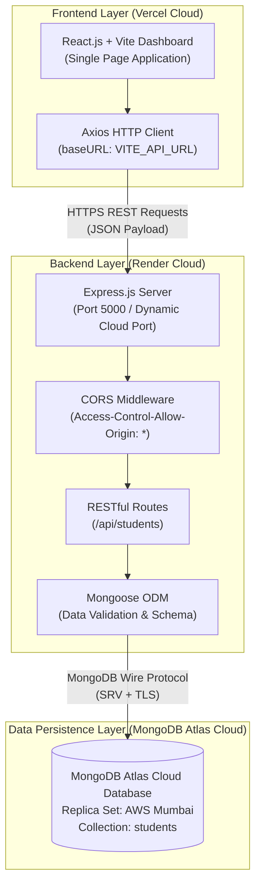

# 🎓 Student Management System — Cloud Deployed Full-Stack Web Application

**Course:** Web Application Architecture & Cloud Deployment  
**Student Name:** Hari Charan  
**Roll Number:** A24126552080  
**Allocated Question:** Question 6 (10 Marks)  

---

## 🌐 Live Production Links

- **Frontend (Vercel):** [https://full-stack-eight-kappa.vercel.app](https://full-stack-eight-kappa.vercel.app)
- **Backend API (Render):** [https://student-api-a24126552080.onrender.com](https://student-api-a24126552080.onrender.com)
- **Database:** MongoDB Atlas (AWS Mumbai, M0 Cluster)
- **GitHub Repository:** [https://github.com/emandiharicharan24csm-arc/Full-Stack/tree/main/student-management-system](https://github.com/emandiharicharan24csm-arc/Full-Stack/tree/main/student-management-system)

---

## 🏛️ System Architecture



---

## ✨ Features

- **Full CRUD Operations:**
  - **Create:** Add new students with field validation (Name, Roll No, Email, Department, Year).
  - **Read:** Real-time retrieval of all records from MongoDB Atlas.
  - **Update:** Pre-populates the form for editing existing students.
  - **Delete:** Interactive confirmation prompt and database removal.
- **Client-Side Real-Time Search:** Instant filtering across student name, roll number, department, and email.
- **Production Cloud Deployment:**
  - Decoupled frontend deployed to **Vercel** with global CDN edge routing.
  - Express REST API deployed to **Render** with automated build triggers.
  - Cloud database hosted on **MongoDB Atlas** with `0.0.0.0/0` IP access.
- **Responsive UI:** Custom CSS designed with clean card layouts, subtle gradients, and status banners.

---

## 🛠️ Technology Stack

| Layer | Technology | Description |
|---|---|---|
| **Frontend** | React 18, Vite | High-performance SPA with Hot Module Replacement |
| **HTTP Client** | Axios | Promise-based asynchronous HTTP request library |
| **Backend** | Node.js, Express.js | Lightweight, fast REST API server framework |
| **Database** | MongoDB Atlas, Mongoose | Cloud NoSQL document database and schema modeling |
| **Environment Management** | dotenv | Zero-exposure secrets management |
| **Hosting & Cloud** | Vercel, Render | Serverless edge hosting and cloud container deployment |

---

## 📁 Project Directory Structure

```text
student-management-system/
├── client/                      # React Frontend
│   ├── public/                  # Favicons & static SVGs
│   ├── src/
│   │   ├── components/
│   │   │   ├── Navbar.jsx       # Header bar displaying roll number
│   │   │   ├── StudentForm.jsx  # Controlled form for Add & Edit
│   │   │   └── StudentList.jsx  # Table rendering & real-time search
│   │   ├── services/
│   │   │   └── api.js           # Axios instance with VITE_API_URL
│   │   ├── App.jsx              # Main state container & CRUD handlers
│   │   ├── App.css              # Custom component styles
│   │   ├── index.css            # Global CSS reset
│   │   └── main.jsx             # React DOM entry point
│   ├── .env                     # Local frontend environment variables
│   ├── vercel.json              # Vercel SPA rewrite configuration
│   ├── vite.config.js           # Vite build configuration
│   └── package.json
│
├── server/                      # Express Backend
│   ├── config/
│   │   └── db.js                # Mongoose connection & DNS resolution
│   ├── models/
│   │   └── Student.js           # Student Mongoose Schema & validation
│   ├── routes/
│   │   └── studentRoutes.js     # 5 CRUD endpoints (/api/students)
│   ├── .env                     # Local backend secrets (PORT, MONGODB_URI)
│   ├── server.js                # Express app initialization & CORS setup
│   └── package.json
│
├── .gitignore                   # Root gitignore protecting all .env files
└── README.md                    # Project documentation
```

---

## 📡 REST API Documentation

Base URL: `https://student-api-a24126552080.onrender.com/api/students`

| Method | Endpoint | Description | Status Code |
|---|---|---|---|
| `GET` | `/` | API health check & developer info | `200 OK` |
| `GET` | `/api/students` | Retrieve all student records | `200 OK` |
| `GET` | `/api/students/:id` | Retrieve single student by ID | `200 OK` / `404 Not Found` |
| `POST` | `/api/students` | Create new student record | `201 Created` / `400 Bad Request` |
| `PUT` | `/api/students/:id` | Update student record by ID | `200 OK` / `400 Bad Request` |
| `DELETE` | `/api/students/:id` | Delete student record by ID | `200 OK` / `404 Not Found` |

### Sample JSON Payload (Create / Update):
```json
{
  "name": "Hari Charan",
  "rollNumber": "A24126552080",
  "email": "haricharan@amity.edu",
  "department": "CSE",
  "year": "3"
}
```

---

## ⚙️ Local Development Setup

### 1. Clone Repository:
```bash
git clone https://github.com/emandiharicharan24csm-arc/Full-Stack.git
cd Full-Stack/student-management-system
```

### 2. Backend Setup:
```bash
cd server
npm install
```
Create a `.env` file in the `server` directory:
```env
PORT=5000
MONGODB_URI=your_mongodb_connection_string
```
Start backend:
```bash
npm start
# Server runs on http://localhost:5000
```

### 3. Frontend Setup:
Open a new terminal:
```bash
cd client
npm install
```
Create a `.env` file in the `client` directory:
```env
VITE_API_URL=http://localhost:5000/api/students
```
Start frontend:
```bash
npm run dev
# Vite runs on http://localhost:5173
```
